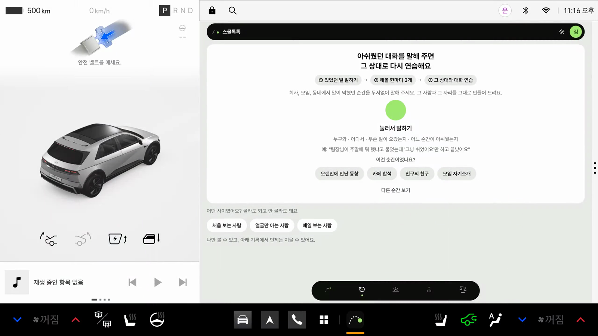
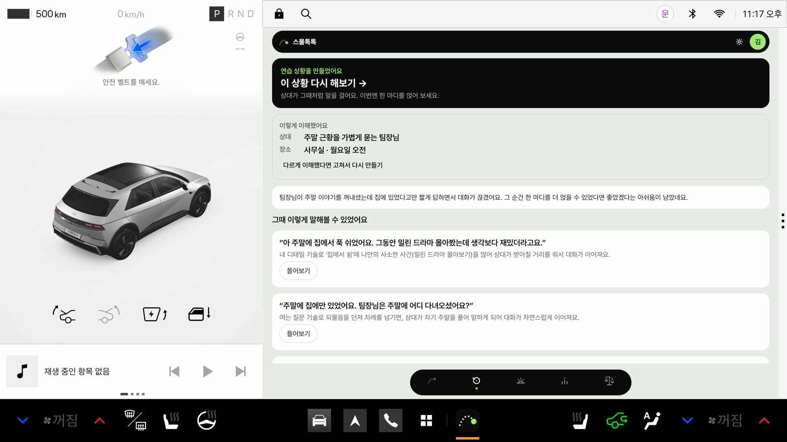
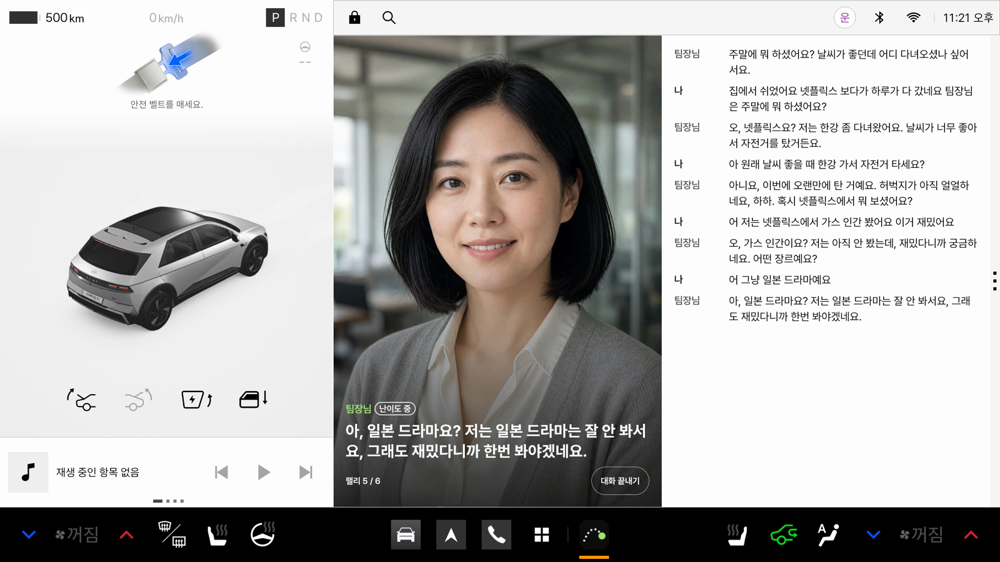
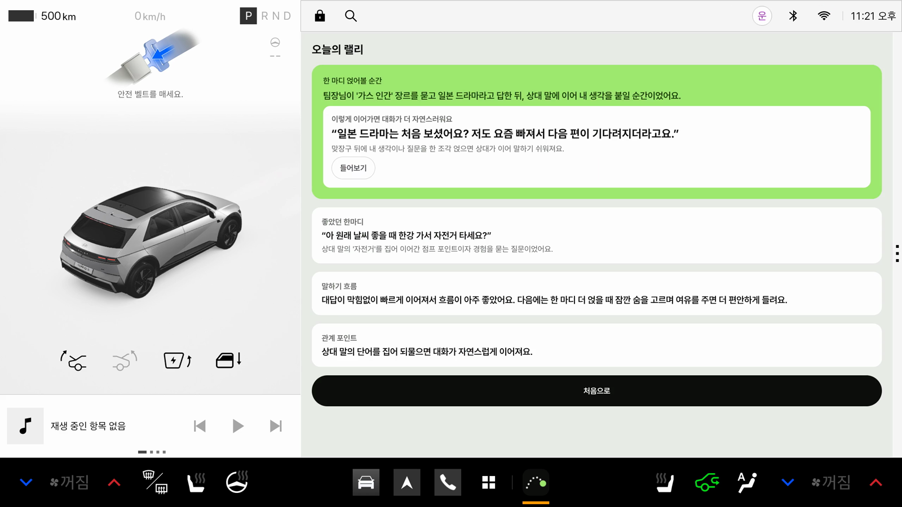
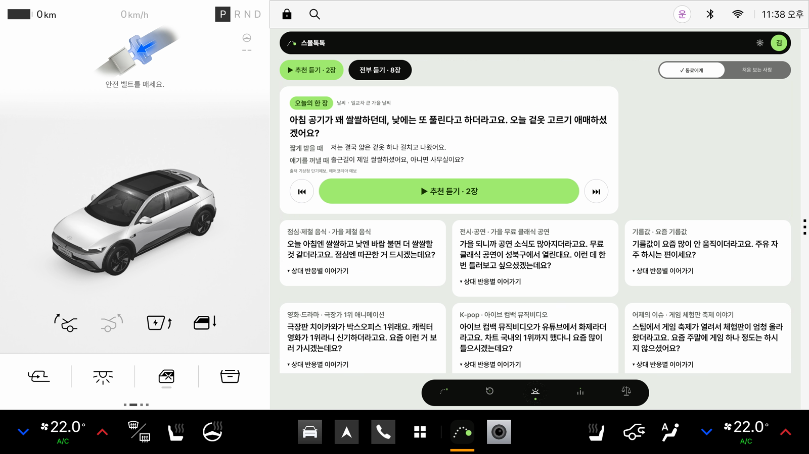
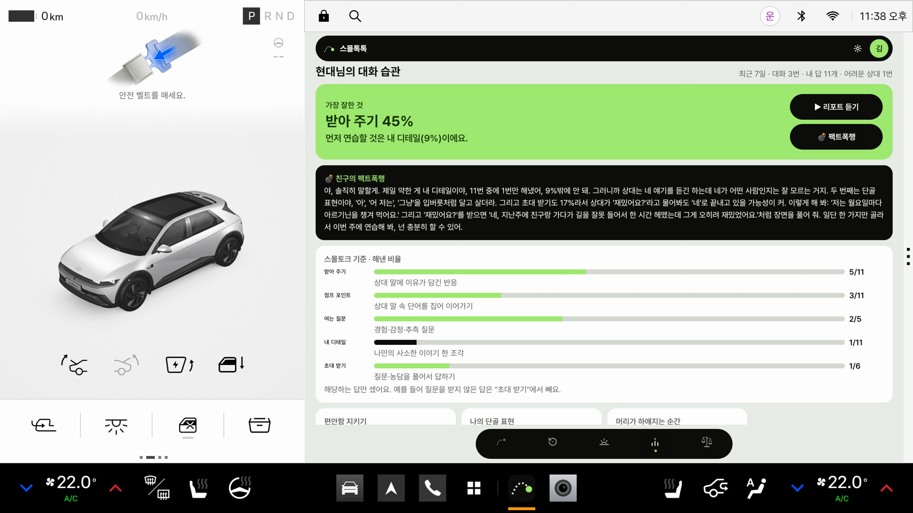
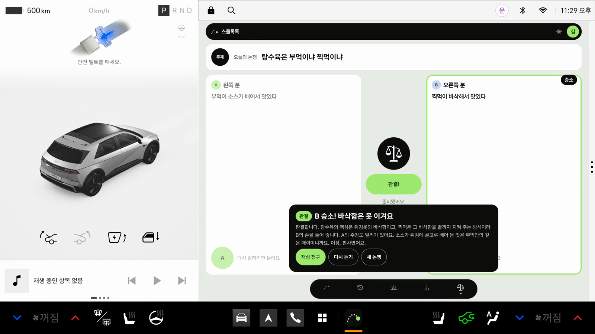
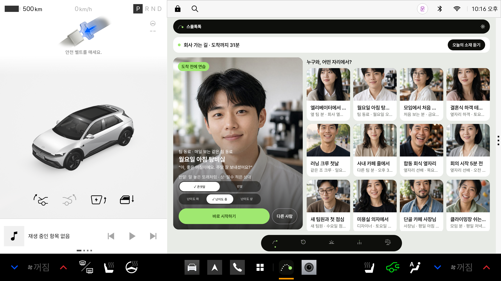
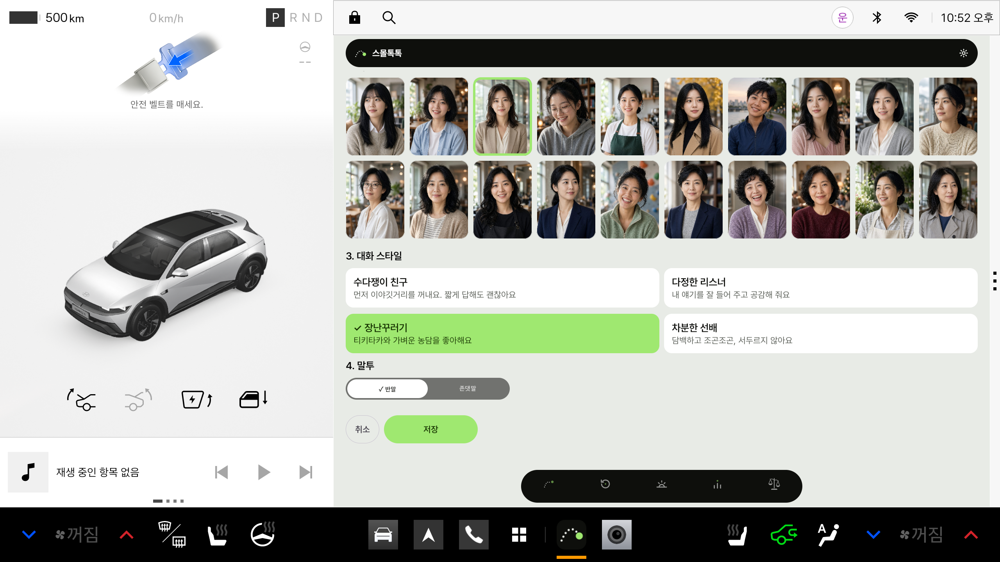
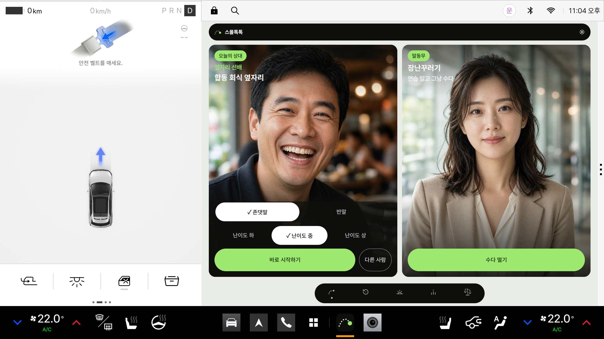

<p align="center">
  
</p>

<h1 align="center">스몰톡톡 (SmallTalkTalk)</h1>

<p align="center">혼자 타는 차 안, 내향인을 위한 가장 안전한 대화 연습실</p>

## 어떤 앱인가요

내향형 직장인에게 스몰토크는 매일의 숙제예요. 동료가 "주말에 뭐 했어요?" 하고 물으면 "하하, 그냥 집에 있었어요"로 끝나 버리고, 집에 와서야 할 말이 떠오르죠.

스몰톡톡은 **자동차로 혼자 출퇴근하는 내향인**을 위한 차량용 앱이에요. 내향인은 사람을 만나기 전에 입을 예열할 시간이 필요하고, 퇴근 후 혼자 차에 타는 순간 비로소 안전한 공간에 들어왔다고 느껴요. 그래서 차는 남의 눈 없이 소리 내어 연습할 수 있는 가장 좋은 연습실이에요.

- **출근길**: 오늘 던질 소재 카드를 음성으로 듣고 입을 예열해요.
- **퇴근길**: AI 상대와 말로 대화를 연습하거나, 아쉬웠던 대화를 털어놓고 그 상대와 다시 연습해요.
- **차가 아는 맥락**: 내비게이션 목적지를 읽어 회사 가는 길엔 아침 카드를, 집 가는 길엔 털어놓기를 권하고, 미용실·카페처럼 가는 곳에 맞는 상대를 골라 줘요.
- **그냥 심심할 때**: 연습이 아니라 내가 고른 말동무와 수다를 떨 수도 있어요.

목표는 수다쟁이가 되는 게 아니라, 맞장구에 **내 생각 한마디**를 얹는 거예요.

## 앱 화면

| | |
|---|---|
| <br>**저녁 연습** 오늘의 상대와 상황 고르기 | <br>**아쉬운 대화** 있었던 일을 말로 털어놓기 |
| <br>**추천 한마디** 그 상대로 다시 연습하기 | <br>**대화 연습** AI 상대와 목소리로 주고받기 |
| <br>**코칭** 한마디 더 얹어 볼 순간 | <br>**아침 카드** 출근길 입 예열 브리핑 |
| <br>**나의 대화 습관** 최근 7일 리포트 | <br>**AI 판사** 차 안 논쟁 판결 |
| <br>**출근길** 목적지가 회사면 오늘의 소재 듣기 | <br>**퇴근길** 목적지가 집이면 털어놓기 추천 |
| <br>**말동무 만들기** 사진·대화 스타일·말투 고르기 | <br>**주행 중 홈** 연습 상대와 말동무, 큰 카드 두 장 |

## 주요 기능

| 탭 | 기능 |
|---|---|
| 저녁 연습 | "누구와, 어떤 자리" 상황을 골라 AI 상대와 목소리로 자유 대화. 끝나면 좋았던 한마디와 "한마디 더 얹어 볼 순간"을 코칭해요. 반말·난이도(하·중·상)를 고를 수 있어요. |
| 아쉬운 대화 | 아쉬웠던 대화를 말로 털어놓으면 추천 한마디 3개를 들려주고, 그 상대와 다시 연습해요. |
| 아침 카드 | 날씨·영화·스포츠 같은 오늘의 소재와 던질 말을 음성 브리핑으로 들려줘요. 월·수·금 "그거 아세요?"는 신기한 지식과 왜 그런지, 언제 어떻게 꺼내면 자연스러운지까지 알려 줘요. |
| 나의 대화 습관 | 최근 7일 대화에서 잘한 것과 먼저 연습할 것을 리포트로 보여 주고 읽어 줘요. |
| AI 판사 | 여럿이 탄 차에서 장난스러운 논쟁을 판결해 주는 재미 기능이에요. |
| 내비 연동 (저녁 연습 홈) | 내비 안내 중이면 "○○ 가는 길 · 도착까지 n분"을 보여 줘요. 즐겨찾기 회사로 가면 "오늘의 소재 듣기", 집으로 가면 "털어놓기"를 권하고, 목적지 이름(미용실·카페·등산로 등)에 맞는 상대를 "도착 전에 연습"으로 골라 줘요. 목적지는 앱 안에서만 쓰고 서버로 보내지 않아요. |
| 말동무 (저녁 연습 홈) | 인물 사진·대화 스타일(수다쟁이 친구·다정한 리스너·장난꾸러기·차분한 선배)·말투를 골라 만든 말동무와 수다를 떨어요. 말동무는 자기만의 일상(하는 일·취미)이 있어서 그 이야기나 지금 시간·출퇴근길로 먼저 말을 걸고, 끝나도 코칭이나 기록이 남지 않아요. |

운전 중에는 화면이 주행용으로 바뀌어요. 글이 많은 화면은 숨기고, 큰 버튼과 음성으로만 쓸 수 있어요.

## 실행 방법

1. Pleos Connect 에뮬레이터를 켜요.
2. 아래 두 APK 중 하나를 설치해요. 두 파일은 내용이 같은 서명된 release 빌드(v1.2)예요(GitHub Release는 첨부 파일 이름의 한글을 지워서 영문 이름으로 올렸어요).

   | 위치 | 파일 |
   |---|---|
   | 저장소 `apk/` 폴더 | `apk/정형민_smalltalktalk_release.apk` |
   | GitHub Release [v1.2.0](https://github.com/caramelpopcornKHU/smalltalktalk-pleos/releases/tag/v1.2.0) | `ChungHyungmin_smalltalktalk_release.apk` |

   ```bash
   adb install apk/정형민_smalltalktalk_release.apk
   ```
   또는 APK 파일을 에뮬레이터 창에 끌어다 놓아요.
3. 앱 목록에서 "스몰톡톡"을 열어요. 처음 실행할 때 마이크·내비게이션 권한을 허용해 주세요.
4. (선택) 내비 연동을 보려면 에뮬레이터 내비에서 즐겨찾기 집·회사를 등록하고 목적지 안내를 시작한 뒤 앱을 열어요.

## 테스트 환경과 필요한 설정

| 항목 | 내용 |
|---|---|
| 에뮬레이터 | Pleos Connect Emulator v2.1.0 (Android API 34), Cold boot, RAM 4GB |
| 앱 | minSdk 28, Kotlin, Jetpack Compose |
| 권한 | 마이크(음성 인식), 인터넷, 내비게이션 경로 정보(`NAVI_ROUTE`) |
| 로그인 | 필요 없어요. 처음 켤 때 익명 계정이 자동으로 만들어지고, 모든 기능을 바로 쓸 수 있어요. |
| 서버 | AI 대화·코칭·음성 합성은 서버(Supabase)에서 처리해요. 인터넷 연결이 필요해요. |

## APK 위치

- 저장소: [`apk/정형민_smalltalktalk_release.apk`](apk/)
- GitHub Release: https://github.com/caramelpopcornKHU/smalltalktalk-pleos/releases/tag/v1.2.0 (`ChungHyungmin_smalltalktalk_release.apk`, 같은 파일)
- 이전 버전: [v1.1.0](https://github.com/caramelpopcornKHU/smalltalktalk-pleos/releases/tag/v1.1.0)(말동무 프로필·지식 카드 개편 전), [v1.0.0](https://github.com/caramelpopcornKHU/smalltalktalk-pleos/releases/tag/v1.0.0)(내비 연동·말동무 전)

## 사용 기술

- Pleos Playground SDK: SpeechToText(음성 인식), TextToSpeech(음성 합성), NaviHelper(목적지·남은 시간·즐겨찾기 집/회사)
- AAOS CarUxRestrictions: 주행 상태에 따라 화면 전환 (`distractionOptimized` 선언)
- Kotlin, Jetpack Compose
- 서버: Supabase(인증·DB·Edge Functions), Claude(대화·코칭), Google Cloud TTS(상대 목소리)

## 오픈소스·저작권 고지

앱 설정 → "오픈소스·저작권 고지"에서 볼 수 있어요. 목록은 [docs/credits.md](docs/credits.md)에 있어요.

## 문의

- 이메일: smalltalktalk.official@gmail.com
- 인스타그램: [@smalltalktalk.official](https://www.instagram.com/smalltalktalk.official/)

앱 설정 화면 아래에서도 볼 수 있어요.
